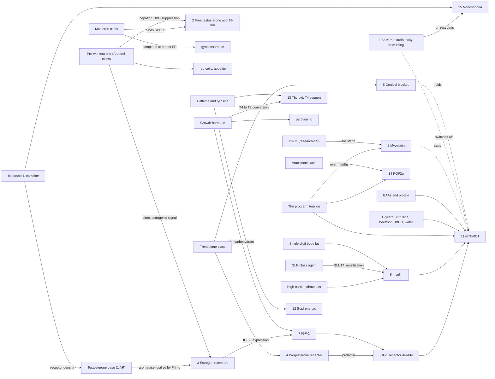

> [!abstract] Performance Enhancement · Part 2, the compounds · page 5 of 15
> Part 1 wrote the plan. This page maps every lever that plan can pull: fifteen pathways (the eight receptor pathways that compounds work, and the seven that food, training and the body's own brakes work), each with its mechanism, its levers and its marker; how they feed each other; a lean bulk built to cover all of them wide and low; and what each phase pulls. *Restructured in November 2026 from "The Eight Anabolic Pathways" and "Pathways by Phase".*
>
> **Previous:** [[Part 1.3 - Running the Course|1.3 Running the Course]] · **Next:** [[Part 2.1 - The Anabolic Steroid Family Tree|2.1 The Family Tree]]

> [!example]- Series map: all 15 pages
> **Part 1 · The plan** (why, what for, the course and its sequence, how it is run and what it costs)
> - [[Part 1.0 - The Decision|1.0 The Decision]]: whether, and when you are ready
> - [[Part 1.1 - Goal Design|1.1 Goal Design]]: what for, in numbers
> - [[Part 1.2 - Course Design|1.2 Course Design]]: courses not cycles; cut or build; which comes first, how long, the KPIs, the courses in sequence
> - [[Part 1.3 - Running the Course|1.3 Running the Course]]: the ladder, the sequencing rules, the clocks, and the bill
>
> **Part 2 · The compounds** (what goes in the stack)
> - **2.0 The Anabolic Pathways** (you are here)
> - [[Part 2.1 - The Anabolic Steroid Family Tree|2.1 The Family Tree]]: the compounds by family and binding
> - [[Part 2.2 - The Extra Compounds|2.2 The Extra Compounds]]: everything beside the anabolics
>
> **Part 3 · Screening and protection** (what it costs and how you measure and defend it; read as one arc: the map, the panel, organ defence, water and minerals, the axis)
> - [[Part 3.0 - The Risk Map|3.0 The Risk Map]]: what the trade costs
> - [[Part 3.1 - Medical Screening and Monitoring|3.1 Medical Screening and Monitoring]]: the blood panel
> - [[Part 3.2 - Continuous Monitoring|3.2 Continuous Monitoring]]: between blood draws
> - [[Part 3.3 - Protection|3.3 Protection]]: organ-by-organ defence
> - [[Part 3.4 - When the Numbers Move|3.4 When the Numbers Move]]: when a marker leaves its range
> - [[Part 3.5 - Choosing Your Ancillaries|3.5 Choosing Your Ancillaries]]: which protective agent, and why
> - [[Part 3.6 - Electrolyte Management|3.6 Electrolyte Management]]: water and minerals
> - [[Part 3.7 - Coming Off and PCT|3.7 The Axis: Coming Off and PCT]]: recovery and fertility
>
> Part of [[Part 4.0 - Pharmacology|Fit: Pharmacology]], Tier 3.

## Table of Contents

- [The core idea: stop body-slamming one pathway](#the-core-idea-stop-body-slamming-one-pathway)
- [Growth is a balance, not a switch](#growth-is-a-balance-not-a-switch)
- [Two kinds of lever, and how to read a pathway](#two-kinds-of-lever-and-how-to-read-a-pathway)
- [The map on one page](#the-map-on-one-page)
- [Group A: the receptor pathways](#group-a-the-receptor-pathways)
    - [1. The androgen receptor (AR)](#1-the-androgen-receptor-ar)
    - [2. The SHBG receptor complex](#2-the-shbg-receptor-complex)
    - [3. The estrogen receptors (ERα and ERβ)](#3-the-estrogen-receptors-erα-and-erβ)
    - [4. The progesterone receptor (PR)](#4-the-progesterone-receptor-pr)
    - [5 and 6. Glucocorticoid and mineralocorticoid (cortisol and water)](#5-and-6-glucocorticoid-and-mineralocorticoid-cortisol-and-water)
    - [7. Growth hormone and IGF-1](#7-growth-hormone-and-igf-1)
    - [8. Insulin](#8-insulin)
- [Group B: the brakes](#group-b-the-brakes)
    - [9. Myostatin and follistatin](#9-myostatin-and-follistatin)
    - [10. AMPK](#10-ampk)
- [Group C: the signalling and metabolic pathways](#group-c-the-signalling-and-metabolic-pathways)
    - [11. mTORC1, the integrator](#11-mtorc1-the-integrator)
    - [12. The β-adrenergic receptors](#12-the-β-adrenergic-receptors)
    - [13. Thyroid hormone](#13-thyroid-hormone)
    - [14. Pro-inflammatory signalling (COX-2 and PGF2α)](#14-pro-inflammatory-signalling-cox-2-and-pgf2α)
    - [15. Mitochondrial density and function](#15-mitochondrial-density-and-function)
- [How the pathways feed each other](#how-the-pathways-feed-each-other)
- [A synergistic lean bulk, read as a pathway map](#a-synergistic-lean-bulk-read-as-a-pathway-map)
- [Pathways by phase](#pathways-by-phase)
- [The cut's extra levers](#the-cuts-extra-levers)
- [How this maps back to the Fit framework](#how-this-maps-back-to-the-fit-framework)
- [Part 2.0 Takeaways](#part-20-takeaways)
- [Your Pathway Audit Task List](#your-pathway-audit-task-list)
- [Sources & references](#sources--references)

---

> [!danger] Framing
> This article describes how multiple physiological pathways contribute to muscle growth and how enhanced athletes attempt to influence them. It is harm-reduction education built on the work of Vigorous Steve.[^1] It is **not** a protocol, a prescription, or medical advice. Compounds are named generically and for transparency; **no doses are given for any anabolic, peptide or prescription compound,** including in the worked example. Doses *are* given for over-the-counter supplements, because those are legal and evidence-based. Every compound here carries risk and requires the [[Part 3.1 - Medical Screening and Monitoring|screening]], [[Part 3.2 - Continuous Monitoring|monitoring]], and [[Part 3.3 - Protection|protection]] covered in Part 3.

---
## The core idea: stop body-slamming one pathway

Most enhanced athletes do one thing: they push more and more androgen at the **androgen receptor** and ignore everything else. More testosterone, more trenbolone, higher and higher doses, chasing the same single mechanism until the side effects pile up and the health markers from [[Part 3.0 - The Risk Map|the Risk Map]] fall apart.

Vigorous Steve's framework is the opposite, and it fits this series perfectly. His core philosophy: instead of **body-slamming one pathway** with high doses, **marginally exploit multiple pathways**. Each one contributes maybe an extra **5 to 10%** to your net gains, and tapping all of them adds up to more total muscle than abusing any single compound, with **vastly fewer health risks.**[^1]

Steve counts eight receptor pathways. This page keeps his eight and adds seven that no compound touches directly, because a plan that only counts the receptors leaves half the machine unmanaged. Think of all fifteen less as "drugs to take" and more as **levers to nudge**: most of them can be moved gently, and more than half can be moved without a compound at all.

> [!important] The prerequisite Steve repeats, and so does this whole series
> ==None of this works without proper baseline nutrition.== This is the 90/10 rule from [[Part 4.0 - Pharmacology|the Fit series]] in a different costume: the pathways are the margin. If training, calories, protein, and sleep aren't already excellent, you are nudging levers attached to nothing. Optimise the work first; optimise the pathways second.

---
## Growth is a balance, not a switch

It is tempting to read every pathway as a way to raise muscle protein synthesis. That captures half the equation. Muscle is a balance:

$$\text{Net muscle protein accrual} = \text{synthesis (MPS)} - \text{breakdown (MPB)}$$

and the pathways on this page do six different jobs around that balance, which is why they are not interchangeable and why covering all of them beats maxing one:[^15]

| Job | What it means | Pathways that do it |
|---|---|---|
| **Build** | Raise synthesis: transcription of new contractile protein, more ribosomes to translate it | AR (1), IGF-1 (7), mTORC1 (11), ER (3) |
| **Hold** | Lower breakdown: block cortisol's signal to the ubiquitin-proteasome system, keep insulin's anti-proteolytic signal on | Glucocorticoid (5), insulin (8), β-adrenergic (12) |
| **Add nuclei** | Activate satellite cells and add myonuclei, which raises the ceiling on how big a fiber can get | AR (1), ER (3), IGF-1 (7), PGF2α (14), myostatin released (9) |
| **Partition** | Send glucose and amino acids into muscle rather than fat | Insulin (8), GH (7), PR via trenbolone (4), thyroid (13), low body fat |
| **Hydrate** | Pull water and glycogen into the cell, which is itself a growth signal and a structural one | Insulin (8), mTORC1's swelling input (11), ER (3) |
| **Hold the frame** | Tendons, collagen, joints, the nervous system, the heart that has to carry it | GH (7), ER (3), PR and neurosteroids (4), mitochondria (15) |

Read the compound list of any stack against this table and the duplicates show up at once: three compounds doing "build" and nothing doing "hold" is a stack that will lose on the cut what it gained on the bulk.

---
## Two kinds of lever, and how to read a pathway

The fifteen pathways fall into two kinds. The **receptor pathways** (Group A) are hormones and the receptors they bind; they are mostly pulled with compounds. The **non-receptor pathways** (Groups B and C) are the cell's own brakes, sensors and signalling cascades; they are mostly pulled with food, training, sleep and over-the-counter supplements, and most of the free growth is there.

Every entry below has the same shape, so the page can be read in one pass or used as a reference:

- **Role**: which of the six jobs it does.
- **Mechanism**: what actually happens at the receptor or in the cell, in a few sentences.
- **Direct effect and indirect effects**: what it does on its own, and what it changes in the *other* pathways. The indirect effects are where the synergy lives, and they are usually the real reason a lever is in the stack.
- **Compound levers** (tagged by [[Part 2.1 - The Anabolic Steroid Family Tree|class]]: class 1, class 2, SARM, peptide) and **non-compound levers**.
- **Marker**: the number on the [[Part 3.1 - Medical Screening and Monitoring|panel]] that tells you whether the lever is doing its job or its damage.
- **Lean bulk** and **cut**: one line each, expanded in [[#pathways-by-phase|Pathways by phase]].

Three house rules carry over from the old version of this page: compounds are named generically, never by brand; testosterone is the base and every other compound has to answer "what does this add that test alone, at a sane dose, doesn't?"; and no anabolic doses, by design.[^5]

---
## The map on one page

| # | Pathway | Role | What it does | Compound lever in this series' designs | Non-compound lever | Marker |
|---|---|---|---|---|---|---|
| 1 | Androgen receptor | Build, add nuclei | Transcription of contractile protein; satellite cells; red cells; CNS drive | Testosterone base (class 1) | LCLT or injectable L-carnitine (receptor density), zinc, vitamin D, pin frequency | Total and free T, hematocrit |
| 2 | SHBG complex | Build (delivery) | Carries and frees androgen | Masteron-class (class 1); the pre-workout oral suppresses hepatic SHBG | Boron, magnesium, eat enough | SHBG |
| 3 | Estrogen receptors α and β | Build, hydrate, hold the frame | IGF-1 expression, satellite cells, GLUT4, tendon, HDL, joints | Testosterone via aromatase, dialled by the DHT family; the wet oral; ecdysterone (OTC) | Injection frequency, omega-3 | Sensitive E2 |
| 4 | Progesterone receptor | Build, partition, hold the frame | IGF-1 receptor density, partitioning, sleep architecture | Trenbolone-class at the minimum (class 1) | P5P, pregnenolone, HCG | Prolactin |
| 5 | Glucocorticoid receptor | Hold | Blocks cortisol's catabolic transcription | The same 19-nor; the dry oral on the cut | Carbs around training, sleep, ashwagandha, phosphatidylserine | Cortisol |
| 6 | Mineralocorticoid receptor | (water) | Sodium and water | None by design; the dial keeps the base dry | Steady electrolytes, fluids between meals | Blood pressure, morning weight |
| 7 | GH and IGF-1 | Build, partition, hold the frame | Hepatic and local IGF-1, lipolysis, collagen | Pharmaceutical GH (peptide), with T4 | Sleep, fasted morning, creatine | IGF-1, fasting glucose, FT4 |
| 8 | Insulin | Build, hold, partition, hydrate | mTORC1 input, anti-proteolysis, glycogen, GLUT4 | GLP-class agent (peptide); exogenous insulin only as a carb dependent | Carbohydrate, single-digit body fat, intra-workout HBCD and EAAs | Fasting insulin, HOMA-IR, HbA1c |
| 9 | Myostatin and follistatin | Brake to release | Myostatin caps growth; follistatin lifts the cap | YK-11 (SARM class, research-tier) | Training over time with controlled eccentrics, creatine, epicatechin | None routine |
| 10 | AMPK | Brake to keep off | Energy sensor that switches mTORC1 off | None (metformin and berberine *activate* it) | Cardio away from lifting; intra-workout carbohydrate | Fasting glucose (indirect) |
| 11 | mTORC1 | Build (the integrator) | Sums insulin, sensitivity, tension, swelling and amino acids | None directly | Carbs, body fat, the program, the pre-workout swelling stack, EAAs and protein | Progress on the bar |
| 12 | β-adrenergic receptors | Hold, partition | cAMP signalling: anti-catabolic in muscle, lipolytic in fat | Mirabegron or the clenbuterol class on the cut only | Caffeine and tyrosine pre-workout | Resting heart rate, blood pressure |
| 13 | Thyroid hormone | Partition, hold the frame | Metabolic rate, MHC transcription, insulin sensitivity | T4 support under GH; T3 on the cut | Tyrosine, iodine, selenium | FT3, FT4, TSH, basal temperature |
| 14 | Pro-inflammatory signalling | Add nuclei | COX-2 to PGF2α: satellite cell fusion, local hypertrophy | None | Training; arachidonic acid pre-workout; no NSAIDs, antioxidants away from training | None routine |
| 15 | Mitochondria | Hold the frame, partition | Fuel oxidation, recovery, the heart's engine | The cut's toolbox ([[Part 2.2 - The Extra Compounds|2.2]]) | Zone 2 on rest days, injectable L-carnitine, CoQ10, NR, omega-3 | VO2 trend, resting heart rate |

Read the fifth column top to bottom and it is the lean-bulk stack from [[Part 1.2 - Course Design|Part 1.2]]: one compound per receptor pathway, and the brakes and signalling pathways covered by behaviour. That is what "marginally exploit every pathway" looks like when it is finished.

---
## Group A: the receptor pathways

### 1. The androgen receptor (AR)

**Role:** build, add nuclei. **Lever:** compounds, class 1.

**Mechanism.** The route targeted by anabolic-androgenic steroids and SARMs. An androgen binds the receptor; the activated receptor moves into the nucleus and drives transcription of DNA into RNA, which is read to synthesise new contractile protein. This is the dominant, most powerful muscle-building mechanism, and it is exactly the one people overdose. The under-appreciated detail: when a receptor activates and moves to the nucleus it **leaves the cell membrane**, and the body has to replenish it. The number of available receptors, **AR density**, is itself a lever, and the one most people never think to optimise.[^6] The genomic route is slow (hours to days); the non-genomic route (membrane signalling, neurotransmission, the psychoactive effects) is why strength and drive rise before any tissue exists ([[Part 2.1 - The Anabolic Steroid Family Tree|2.1]]).

**Direct effect.** New contractile protein. **Indirect effects.** Androgens activate satellite cells and add myonuclei, which raises the ceiling on fiber size and is the basis of muscle memory;[^16] they stimulate erythropoiesis (strength, endurance, and the hematocrit cost); they raise central drive. The testosterone base also *feeds* two other pathways: it aromatises to estradiol (pathway 3) and reduces to DHT, so it is never "just" the AR lever.

> [!example] Compound levers (chosen by the job)
> Every AAS acts here; they differ in side-effect profile and secondary traits.[^5]
> - **Testosterone (class 1, T family)**: the base of essentially every protocol; raises everything beyond natural capacity, and the same molecule used for replacement as natural production declines.
> - **Methenolone / "Primo" (class 1, DHT family)**: milder anabolism with a "cosmetic" look, chosen when extra testosterone causes too many sides. In this series' designs it is the aromatase *dial* (pathway 3) and the second, mild AR signal.
> - **Boldenone, Turinabol, Dianabol, Superdrol**: offseason AR tools with specific side-effect trade-offs; none is in this series' designs because none covers a job the base, the dial and the pre-workout oral don't. Boldenone in particular pushes hematocrit hard ([[Part 3.2 - Continuous Monitoring|3.2]]).
> - **SARMs**: included for completeness; serious athletes favour AAS, GH and IGF-1 over SARMs for this pathway. The one SARM in this series' example works pathway 9, not this one.
>
> Notice the logic: most of these exist to deliver AR anabolism *while dodging a specific side effect* of running more testosterone, not to be piled on top of an already-high test dose for its own sake.

> [!tip] Food, training and OTC levers
> - **L-carnitine**: L-carnitine L-tartrate, ~2 g/day orally, raises androgen-receptor content in muscle after resistance exercise; the injectable form does the same without the absorption and TMAO problems of oral ([[Part 2.2 - The Extra Compounds|2.2]]).[^6] More receptors means more of your existing androgen actually gets used.
> - **Zinc, ~25 to 30 mg/day** (with 1 to 2 mg copper long-term): deficiency suppresses androgen signalling; correcting it restores it; more adds nothing.[^7]
> - **Vitamin D, dosed to a blood level of ~40 to 60 ng/mL**; **selenium, ~100 to 200 mcg/day**.[^13]
> - **Pin frequency**: splitting the weekly dose into more frequent injections keeps serum androgen and estrogen stable instead of spiking; smoother receptor occupancy, fewer estrogen swings.

**Marker:** total and free testosterone, hematocrit, lipids. **Lean bulk:** a testosterone base at the level the training stress derives. **Cut:** the same base lowered to a near-replacement band; the cut holds muscle with the 19-nor, the dry oral and the food, not with more androgen.

### 2. The SHBG receptor complex

**Role:** build (delivery). **Lever:** compounds, class 1, and the liver.

**Mechanism.** Sex hormone-binding globulin gets a bad reputation as a sponge that mops up free testosterone. That is incomplete. The **SHBG-receptor complex is itself a delivery system**, a mailing service that carries androgens to tissue, where they activate nuclear receptors.[^1] Drive SHBG too low and you damage that delivery mechanism, which is why the reflex to "get SHBG as low as possible for more free test" can backfire, and why high-dose courses, which crush SHBG automatically, do not get proportionally more out of their androgen.

**Direct effect.** More free testosterone and free 19-nor per milligram injected. **Indirect effects.** The compounds that lower SHBG are not neutral elsewhere: the DHT family also competes at the estrogen receptor (pathway 3), and the 17α-alkylated orals that suppress SHBG do so through the liver, with the liver's bill.

> [!example] Compound levers
> - **Drostanolone / "Masteron" (class 1, DHT family)**: binds SHBG, freeing testosterone and trenbolone, and competes at the estrogen receptor in breast tissue, which matters when a prolactin-raising 19-nor and an estrogenic oral are both in the stack. The optional SHBG lever in this series' lean bulk.[^5]
> - **Mesterolone / "Proviron" (class 1, DHT family)**: the same job; not in this series' designs because Masteron already covers the node.
> - **The 17α-alkylated orals: Anavar, Winstrol, Anadrol.** Anything processed through the liver suppresses hepatic SHBG synthesis, and these do it hard; it is one of the reasons a pre-workout oral "frees" the injectables around it. Anadrol does it on the bulk, Anavar on the cut, as a side effect of the job each is there for.[^17]
>
> *The DHT family are the SHBG levers by binding; the orals are SHBG levers by production. Both count against the delivery function if pushed.*

> [!tip] Food, training and OTC levers
> - **Boron, ~10 mg/day**: a small human study found it reduced SHBG and raised free testosterone (and free estradiol) within a week; cheap and the single most evidence-backed OTC SHBG nudge.[^8]
> - **Magnesium, ~200 to 400 mg/day elemental**: modestly lowers SHBG binding, especially in hard-training, heavy-sweating athletes.[^8]
> - **Don't chronically under-eat.** Very low energy availability *raises* SHBG. Sometimes the fix is food.

**Marker:** SHBG, which the [[Part 3.1 - Medical Screening and Monitoring|hormone panel]] flags for exactly this reason. **Lean bulk:** optional Masteron-class. **Cut:** out; with the base low there is little to free up, and the dry oral suppresses SHBG anyway.

### 3. The estrogen receptors (ERα and ERβ)

**Role:** build, hydrate, hold the frame. **Lever:** the base via aromatase, dialled; the wet oral; an OTC agonist.

**Mechanism.** Estrogen is not a side effect to be suppressed. It has **moderate, independent anabolic effects** of its own through two receptors.[^3] **ERα** in muscle raises IGF-1 expression and IGF-1 receptor density, activates satellite cells, drives GLUT4 translocation (glucose uptake into muscle), protects the membrane against eccentric damage, and supports tendon collagen; in the liver it holds HDL up; in bone it holds density. The same receptor in breast tissue is the gyno pathway, and estrogen's cross-talk with the mineralocorticoid system is part of the water. **ERβ** is the regenerative and anti-proliferative twin: it opposes ERα in breast tissue and is the receptor ecdysterone is proposed to act on.[^4][^18] Testosterone covers both the androgen and the estrogen pathways at once, because it aromatises; the question is never whether to have estrogen but how much, and from where.

**Direct effect.** Anabolism and partitioning of its own; the IGF-1 signal is raised at both ends (expression and receptor). **Indirect effects.** ==Over-suppressing estrogen with aromatase inhibitors kills this pathway== and tanks lipids, joints, libido and mood at the same time. This is one of the most common newbie mistakes, also flagged by Derek: unnecessary AI use that limits fat loss and muscle accrual while wrecking the lipid panel.[^2]

> [!example] Compound levers
> - **The testosterone base, aromatised**, is the main source of estrogen signal. **The DHT dial (Primobolan-class, Masteron-class)** modulates how much of it there is, without the lipid strain of a suicidal AI: that is the estrogen-management tool in this series' lean bulk ([[Part 2.1 - The Anabolic Steroid Family Tree#The family tree in motion: wet vs. dry is a setting, not a property|the wet/dry section]]).
> - **The wet oral (Anadrol-class, class 2)**: a DHT derivative that does not aromatise yet is estrogenic in its own right, so it activates this pathway directly: partitioning, IGF-1 expression, red-cell mass, appetite. It is in the lean bulk *for* this pathway.
> - **Ecdysterone (OTC)**: a plant steroid proposed to act through ERβ; a small RCT in resistance-trained men found improved gains, with an unsettled mechanism and wildly variable supplement quality.[^4] The one estrogen-pathway lever with no feminising side.
> - **Aromatase inhibitors** (ancillaries, not in the family tree): control serum estrogen *while running aromatising AAS*; the minimum that works, and only when the dial isn't enough; exemestane when other AIs drag lipids.[^5]
> - **SERMs (tamoxifen, raloxifene)**: block estrogen at breast tissue without lowering it systemically; the gyno tool, and tamoxifen's [[Part 3.7 - Coming Off and PCT|PCT]] role.
>
> ==The job of this pathway is restraint: keep estrogen in range, reach for AIs sparingly, and never confuse "dry" with "anabolic."==

> [!tip] Food, training and OTC levers
> - **Injection frequency first.** Smaller, more frequent doses smooth aromatisation, so you may need little or no AI at all.[^1]
> - **Omega-3 (EPA/DHA), 2 to 4 g/day** plus broader lipid support, because the whole reason *not* to crush estrogen is partly cardiovascular ([[Part 3.3 - Protection|3.3]]).
> - **Track sensitive E2** on [[Part 3.2 - Continuous Monitoring|ongoing]] and [[Part 3.1 - Medical Screening and Monitoring|mid-course]] bloods; the target is "controlled and in range," not "as low as possible."

> [!warning] The AI trap
> Crashing estrogen feels productive (less bloat, less gyno worry), but flat estradiol brings joint pain, dead libido, low mood, brittle lipids and a *blunted* anabolic response. The fix is almost always injection frequency, or the DHT dial, not more AI.

**Marker:** sensitive E2; HDL. **Lean bulk:** some estrogen is *wanted*: the base, the dial, the wet oral. **Cut:** little to aromatise at a low base; the dial comes out; dryness comes from the DHT-derivative oral instead.

### 4. The progesterone receptor (PR)

**Role:** build, partition, hold the frame. **Lever:** the 19-nor, class 1, at the minimum.

**Mechanism.** Progesterone-receptor stimulation contributes its own anabolic benefit, which is part of why the **19-nor** derivatives (nandrolone, trenbolone, MENT) feel so potent: they hit the PR hard on top of the androgen receptor.[^1] The prolactin that follows PR activity is the cost, but it is not only a cost: prolactin and progesterone signalling are read in this series as a second route to **IGF-1 receptor density** and local IGF-1 expression, alongside estrogen's.[^19] Progesterone and its neurosteroid metabolites also shape sleep architecture and central recovery, which is why the 19-nors change how you sleep in both directions.

**Direct effect.** Anabolism and partitioning beyond what the AR alone gives. **Indirect effects.** Prolactin up, which crushes libido and, with estrogen present, raises the gyno risk; this is why the Masteron-class (pathway 2) competing at the breast ER is in the same stack as a 19-nor and an estrogenic oral. The trenbolone-class also carries pathway 5 (below), which is the main reason it is the 19-nor the series keeps.

> [!example] Compound levers
> - **Trenbolone (class 1, 19-nor)**: the one 19-nor in this series' designs, at the lowest level that does the job: IGF-1 receptor density and sensitivity, intramuscular IGF-1 expression, partitioning (it blocks lipid uptake into adipose), vascularity; and through pathway 5, anti-catabolism in a deficit. Raises prolactin; costs sleep and mood.[^5]
> - **Nandrolone (class 1, 19-nor)**: hits the PR too; its standout secondary job is joint and connective-tissue lubrication in the offseason. Raises prolactin and holds water. Not in this series' designs.
> - **Pregnenolone**: the upstream precursor; supports the pathway gently and improves cognition and sense of well-being on a course when neurosteroid production downregulates.
> - **Dopamine agonists (cabergoline, bromocriptine)**: the *brake*, not the gas: they control the prolactin that heavy 19-nors raise; potent, physician territory, and itself an argument for not over-running 19-nors.

> [!tip] Food, training and OTC levers
> - **Vitamin B6 as P5P, ~50 to 200 mg/day** meaningfully lowers prolactin (it is used clinically for exactly that), the first-line OTC nudge before any dopamine agonist.[^14] Add up every B6 source in the stack: high cumulative pyridoxine is a neuropathy risk.
> - **HCG / HMG on a course** maintains baseline progesterone and testicular function (also the fertility play in [[Part 3.7 - Coming Off and PCT|3.7]]).
> - **Vitamin E** and adequate **zinc** modestly help keep prolactin in check; **low-dose sublingual micronised progesterone** maintains a baseline without 19-nors, per Steve.[^1]

**Marker:** prolactin, which moves onto the panel the moment a 19-nor is in the stack. **Lean bulk:** trenbolone-class at the minimum, P5P beside it. **Cut:** the same compound, the same job, more important: the strongest case for the 19-nor is anti-catabolism in a deficit.

### 5 and 6. Glucocorticoid and mineralocorticoid (cortisol and water)

**Role:** hold (5); water (6). **Lever:** the 19-nor and the dry oral; food, sleep and minerals.

**Mechanism.** These two are different in kind. They don't build muscle; one **stops muscle breaking down** and the other decides how much water you carry. Cortisol binds the glucocorticoid receptor and switches on the **ubiquitin-proteasome system**, the machinery that tags and degrades contractile protein, hardest in a calorie deficit. Compounds with glucocorticoid-receptor affinity act as antagonists, blocking cortisol from binding; blocking it doesn't raise synthesis, it lowers breakdown, which is the anti-catabolic half of the balance equation.[^15] The mineralocorticoid side is the quieter twin: aldosterone and the renin-angiotensin system set sodium and water retention; compounds and estrogen that stimulate it are what "wet" means ([[Part 2.1 - The Anabolic Steroid Family Tree#The family tree in motion: wet vs. dry is a setting, not a property|wet vs dry is a setting]]), and unstable electrolytes, not the gear, are usually the real driver of edema and the pressure that comes with it ([[Part 3.6 - Electrolyte Management|3.6]]).

**Direct effect.** Lean mass held through a deficit. **Indirect effects.** This is the mechanism that lets an enhanced cut be aggressive and *short* where a natural cut cannot ([[Part 1.2 - Course Design|Course Design]]); it is also why chronic HIIT and under-sleeping, both of which raise cortisol, cost an enhanced athlete more than they think.

> [!example] Compound levers
> - **Trenbolone (class 1, 19-nor)**: high glucocorticoid-receptor affinity makes it powerfully anti-catabolic in a deficit; cap at **~8 weeks** for side-effect reasons.[^1][^5] The reason the 19-nor stays in the cut when the dial compounds come out.
> - **Oxandrolone / Anavar (class 1, DHT family, oral)**: the dry oral of the cut: strength, hardness, mild GR antagonism, collagen support, no water. It takes the pre-workout slot the wet oral held during the bulk.
> - **Stanozolol, Halotestin**: late contest-prep hardness tools; harsh and liver-toxic; short, specific windows only; not in this series' designs.

> [!tip] Food, training and OTC levers (the safer anti-catabolic levers)
> - **Carbohydrate around training.** The simplest anti-catabolic lever there is: glycogen present during and after the session means cortisol has less to do. On a cut, this is why the remaining carbohydrate is concentrated around training ([[Part 1.2 - Course Design|1.2]]).
> - **Sleep.** Cortisol follows the circadian curve; a short night raises it the next day. The seven-hour goal in the cut reference is an anti-catabolic rule, not a comfort.
> - **Ashwagandha (KSM-66), ~300 to 600 mg/day**: repeatedly shown to lower cortisol, and in trained men to modestly improve strength and recovery.[^9] **Phosphatidylserine, ~400 to 600 mg/day** around training blunts the exercise-induced cortisol rise.[^10]
> - **For the water side: steady sodium, potassium, magnesium, calcium and phosphorus day to day**, and fluids between meals rather than with them. Erratic minerals produce the "bloat" that gets blamed on compounds.

**Marker:** cortisol; blood pressure and morning weight for the water. **Lean bulk:** the 19-nor covers it; the dial keeps the base dry. **Cut:** the 19-nor is the anchor, the dry oral joins it, and the carbohydrate that is left goes around training.

### 7. Growth hormone and IGF-1

**Role:** build, partition, hold the frame. **Lever:** pharmaceutical GH (peptide), with thyroid support.

**Mechanism.** GH binds its receptor and signals through JAK2/STAT5. On its own it is a weak direct muscle builder; its power is indirect.[^20] In the liver, with carbohydrate and insulin present, it drives **systemic IGF-1**, and IGF-1 through PI3K/Akt feeds mTORC1 (pathway 11), ribosomal biogenesis (more ribosomes, so more protein per unit of mRNA, the long-term engine of growth) and satellite cells. In muscle, training and the 19-nor raise **local IGF-1** (the MGF splice variant), and estrogen and prolactin raise the density of the receptor it binds; GH supplies the ligand for a receptor the rest of the stack has already sensitised. In fat, GH activates hormone-sensitive lipase: direct lipolysis, and a mild insulin resistance in adipose that, in a surplus, is partitioning. In connective tissue it drives type I and III collagen synthesis, the tendons that have to carry the heavier loads.[^21]

**Direct effect.** More IGF-1, more lipolysis, more collagen. **Indirect effects.** Fasting glucose and insulin sensitivity drift up (pathway 8's cost); T4 is converted to T3 faster and can be depleted (pathway 13), which is why T4 runs beside it; the cancer-marker screening in [[Part 3.1 - Medical Screening and Monitoring|3.1]] exists because of this pathway. GH's job switches with the phase: in a surplus it is a growth and partitioning engine; in a deficit, with carbohydrate low, hepatic IGF-1 output falls and GH is mostly a lipolytic, glycogen-sparing, tissue-preserving tool.

> [!example] Compound levers
> - **Pharmaceutical growth hormone**, scaled to the androgen load per [[Part 1.1 - Goal Design|the equation]]: fasted-morning on the bulk (so its partitioning side works with the first meals); before sleep on the cut (away from the day's lipolytic tools, on top of the natural pulse).
> - **T4 support** during any GH phase (prescription; operating-layer number), because GH accelerates T4-to-T3 conversion and can deplete it.
> - **GH secretagogues (MK-677, the GHRP and GHRH peptides)**: raise endogenous pulses, but they are not in this series' designs. Pharmaceutical GH does the job cleanly, and MK-677's hunger, water under the skin and higher fasting glucose buy nothing GH doesn't ([[Part 2.2 - The Extra Compounds|retired in 2.2]]).
> - **IGF-1 analogues (IGF-1 LR3, DES)**: the open-class tool, deliberately outside this series' designs ([[Part 1.2 - Course Design#The fourth year and after: the horizon|1.2]]); the cancer-marker caveat bites hardest here.

> [!tip] Food, training and OTC levers
> - **Sleep and the fasted morning** protect the natural pulse; both references time the GH to one of them.
> - **Carbohydrate present** when hepatic IGF-1 is the goal (the bulk); absent when lipolysis is the goal (the cut's bedtime dose).
> - **Creatine, 5 g daily** for cell volume alongside the insulin and IGF-1 signal.
> - **A glucose tool if GH nudges fasting glucose** (berberine over the counter; the GLP-class agent or an SGLT2 inhibitor by prescription; not metformin alongside GH, which lowers the systemic IGF-1 the GH is there to raise), decided on the HOMA-IR line in [[Part 3.0 - The Risk Map|the Risk Map]], with a physician.

**Marker:** IGF-1, fasting glucose and insulin, FT4/FT3. **Lean bulk:** GH scaled to the androgen load, fasted morning, T4 beside it. **Cut:** GH at a lower level, before sleep, for the lipolytic side; T3 joins the T4.

### 8. Insulin

**Role:** build, hold, partition, hydrate. **Lever:** carbohydrate, body fat, the GLP-class agent; exogenous insulin only as a dependent.

**Mechanism.** Insulin signals through its tyrosine-kinase receptor to PI3K/Akt, the same cascade IGF-1 uses, into mTORC1 (pathway 11). It is also the body's strongest **anti-proteolytic** signal, suppressing muscle protein breakdown at ordinary post-meal levels,[^22] it drives **GLUT4 translocation** so glucose enters muscle, it refills glycogen, and every gram of glycogen pulls about three grams of water into the cell: the cell swelling that is itself a growth signal and the fullness the physique shows. How much of this lands in muscle rather than fat is **insulin sensitivity**, which is set by body fat, training, sleep, and the agents that sensitise GLUT4.

**Direct effect.** mTORC1 drive, breakdown suppressed, glycogen and water in the cell. **Indirect effects.** Carbohydrate is the lever: the insulin from food is the input the whole bulk is built on, which is why [[Part 1.1 - Goal Design|Goal Design]] derives GH from the androgen load but insulin from the carbohydrate. Exogenous insulin is the most dangerous compound in the kit: hypoglycaemia is immediate and can be fatal, and the risk rises with any mismatch between the dose and the carbohydrate it covers; the series prints the dependency, not the ratio.

> [!example] Compound levers
> - **GLP-1/GIP/glucagon-class peptides (retatrutide)**: GLUT4 sensitisation, so a high carbohydrate intake partitions to muscle on the bulk, at a dose scaled to carbohydrate, not to the androgen load; appetite and partitioning at a fat-loss dose on the cut ([[Part 2.2 - The Extra Compounds|2.2]]).
> - **Exogenous insulin**: only as the dependent of a high-carbohydrate phase, only with a glucose log and a physician, and only after GH, the GLP-class agent and food have been exhausted. Many people should simply skip it.

> [!tip] Food, training and OTC levers
> - **Carbohydrate is the insulin lever you own.** 250 to 300 g a day to start a lean bulk, scaling with training stress toward the reference's long-run target; concentrated around training on a cut ([[Part 1.2 - Course Design|1.2]]).
> - **Body fat in single digits** so the insulin signal actually partitions: the reason there is no dirty bulk, and the reason [[Part 1.2 - Course Design|Course Design]] cuts first.
> - **Intra-workout HBCD and EAAs** keep a mild insulin signal on through the session, GLUT4 active and AMPK (pathway 10) off.
> - **LISS on rest days** and **sleep** for sensitivity; **low-FODMAP, easily digested carbohydrate sources** (cream of rice, jasmine rice), because gut inflammation impairs insulin sensitivity and digestion is the rate limit for an enhanced athlete eating this much.

**Marker:** fasting insulin, HOMA-IR, HbA1c. **Lean bulk:** carbohydrate as the lead variable, the GLP-class agent to sensitise, insulin only as a dependent. **Cut:** carbohydrate around training; the GLP-class agent at a higher dose for appetite; exogenous insulin has no job.

---
## Group B: the brakes

Two pathways that do not build anything. One is a cap on growth that you release; the other is an off-switch that you keep from being thrown at the wrong time.

### 9. Myostatin and follistatin

**Role:** brake to release (add nuclei). **Lever:** training, one research-tier SARM, two mild supplements.

**Mechanism.** Myostatin (GDF-8) is the muscle's own negative regulator. It binds the activin receptor (ActRIIB), signals through Smad2/3, suppresses satellite-cell proliferation and the Akt/mTOR cascade, and keeps a ceiling on fiber size; animals and the rare humans without it are massively muscled.[^23] **Follistatin** is the endogenous inhibitor that binds and neutralises myostatin (and activin). Every anabolic signal on this page runs under this cap; releasing it is permissive rather than anabolic, which is why it belongs with the brakes.

**Direct effect.** A higher ceiling, more satellite-cell activity. **Indirect effects.** Resistance training itself lowers myostatin expression over months, so this pathway rewards time under a program more than any acute intervention.

> [!example] Compound levers
> - **YK-11 (SARM class, research-tier)**: a steroidal, gene-selective partial androgen-receptor agonist that, in a muscle-cell line, induced follistatin expression and myogenic differentiation beyond what DHT produced.[^24] That is the entire evidence base: no human trials, no human safety data, anecdotal liver strain, and the "injectable YK-11" sold by underground labs is unverified compounding of a compound with poor oral bioavailability. It appears in this series' worked example as the user's cover for this pathway, with that caveat attached, not as a recommendation.
> - **Follistatin and ACE-031-class peptides and gene therapies**: research only, outside this series entirely.

> [!tip] Food, training and OTC levers
> - **The program, over time, with controlled eccentrics.** The one lever with real evidence: myostatin expression falls with sustained resistance training.
> - **Creatine, 5 g daily**: one trial in young men found lower serum myostatin with creatine on top of training; modest, cheap, already in the stack.[^25]
> - **Epicatechin, ~100 to 200 mg/day** (the cocoa flavanol): a small human study found follistatin up and myostatin down after a week; thin, but the only OTC follistatin signal with any data.[^26]

**Marker:** none measurable routinely; serum myostatin is not a standard panel item. **Lean bulk:** training and time; the research-tier SARM only with its caveat read. **Cut:** training, held.

### 10. AMPK

**Role:** brake to keep off (and, on the cut, to spend). **Lever:** cardio timing, intra-workout fuel, and what you don't take.

**Mechanism.** AMP-activated protein kinase is the cell's fuel gauge. When ATP falls and AMP rises (hard cardio, fasting, a deep deficit, a session run on empty), AMPK switches on and **turns mTORC1 off** directly, phosphorylating TSC2 and raptor, to conserve energy; it also drives mitochondrial biogenesis through PGC-1α.[^27] That makes it a two-sided lever: catabolic to the growth signal in the hours around lifting, and the engine of the endurance adaptations (pathway 15) that a bulk still needs. The concurrent-training "interference effect" is this pathway.[^28]

**Direct effect.** mTORC1 suppressed while it is active. **Indirect effects.** Metformin and berberine work *by* activating AMPK, which is why metformin blunts training hypertrophy and is kept out of GH phases in this series' designs; why a fasted session with no intra-workout carbohydrate is a session with the brake half on; and why cardio placement, not cardio volume, is the decision.

> [!example] Compound levers
> - **None that help.** The AMPK activators (metformin, berberine, AICAR-class research chemicals) are glucose and endurance tools with a growth cost; where a glucose tool is needed alongside GH, the series uses the GLP-class agent or an SGLT2 inhibitor instead ([[Part 2.2 - The Extra Compounds|2.2]]).

> [!tip] Food, training and OTC levers
> - **Keep cardio away from lifting.** No cardio in the hours around a session; on a bulk, cardio once or twice a week on rest days, low intensity (Zone 2). Chronic HIIT on a high-androgen, low-fat diet raises cortisol and competes with recovery.
> - **Fuel the session.** Intra-workout HBCD and EAAs keep the AMP/ATP ratio from rising during the lifting itself.
> - **On the cut, spend it deliberately.** Fasted morning LISS is where the cut's AMPK budget goes, still kept away from the lifting.

**Marker:** indirect: fasting glucose and training progress. **Lean bulk:** off around lifting; one or two Zone 2 sessions on rest days. **Cut:** used, not avoided: fasted LISS, still separated from the lifting by hours.

---
## Group C: the signalling and metabolic pathways

The five pathways that most people never list, where most of the free growth is, and the ones that decide whether the receptor pathways above have anything to work with.

### 11. mTORC1, the integrator

**Role:** build (the integrator). **Lever:** five inputs, all non-compound.

**Mechanism.** The mechanistic target of rapamycin complex 1 is the node where the growth signals are summed and translated into protein synthesis: it phosphorylates S6K1 and 4E-BP1 and turns on translation. Every anabolic hormone on this page reaches it (androgens indirectly, IGF-1 and insulin through PI3K/Akt), but it has **five inputs of its own that no compound replaces**:[^29]

1. **Insulin and IGF-1** (PI3K/Akt): carbohydrate, and the GH/IGF-1 axis. The lever is pathway 8's: a high-carbohydrate diet, scaled to training stress.
2. **Insulin sensitivity**: the same insulin does more in a sensitive cell. The lever is body fat in single digits, the GLP-class agent, LISS, sleep.
3. **Mechanical tension**: load across the sarcolemma activates focal adhesion kinase and phosphatidic acid synthesis, which activates mTORC1 **independently of any hormone**.[^30] The lever is the program: progressive overload, controlled eccentrics.
4. **Cellular swelling**: a hydrated, glycogen-full cell is read as an anabolic signal. The lever is the pre-workout swelling stack: glycerol 30 g, L-citrulline citrate 8 g, beetroot powder 6 g; HBCD intra-workout, one serving (about 30 g); 6 to 8 L of water a day with electrolytes managed ([[Part 2.2 - The Extra Compounds|2.2]], [[Part 3.6 - Electrolyte Management|3.6]]).[^31]
5. **Amino acids**: leucine through Sestrin2 and the Rag GTPases is the gate that lets mTORC1 reach the lysosome. The lever is intra-workout EAAs, 15 to 20 g, and protein at about 2.2 g per kilogram of target lean mass across the day.

**Direct effect.** Synthesis. **Indirect effects.** Everything upstream is wasted if one input is missing: an androgen base on a low-carbohydrate day with no swelling and a long fast is the receptor half of the machine turning with nothing in the gears.

**Marker:** progress on the bar and the tape; there is no blood number for mTORC1. **Lean bulk:** all five inputs on, every training day. **Cut:** the carbohydrate input is smaller but kept around training; swelling is one of the few growth signals a deficit leaves intact, so citrulline and beetroot stay while glycerol and HBCD come out; amino acids held; tension held.

### 12. The β-adrenergic receptors

**Role:** hold, partition. **Lever:** endogenous catecholamines on the bulk; an agonist on the cut.

**Mechanism.** Adrenaline and noradrenaline act through β-receptors and cAMP/PKA. In muscle, β2 signalling is anti-catabolic and mildly anabolic (the basis of the β2-agonist hypertrophy seen in animals); in fat, β1/β2 and the β3 receptor on brown and beige fat drive lipolysis and thermogenesis. The receptors downregulate under constant stimulation, which is why the agonist drugs need cycling and why this pathway is run on the body's own catecholamines most of the year.

**Direct effect.** Muscle held, fat mobilised, drive and training intensity up. **Indirect effects.** Every agonist here raises heart rate and blood pressure, and the clenbuterol class has killed people, so this is the pathway whose cost is paid by the heart ([[Part 3.0 - The Risk Map|the Risk Map]]).

> [!example] Compound levers
> - **Mirabegron (β3)**: the gentler default on the cut; brown-fat thermogenesis without tremor or receptor cycling, though heart rate and pressure still rise at effective doses.
> - **The clenbuterol class (β2)**: stronger lipolysis and muscle-sparing for a short, late-cut window, with taurine, potassium and ketotifen; never on the bulk. Both in [[Part 2.2 - The Extra Compounds|2.2]].

> [!tip] Food, training and OTC levers
> - **Caffeine, 200 mg, and L-tyrosine, 2 g, pre-workout**: caffeine raises catecholamine release; tyrosine is the precursor to dopamine and noradrenaline (and to thyroid hormone). Together they run this pathway on endogenous signal for the whole bulk, at no cardiac cost beyond the caffeine.
> - **Sleep and stress**: chronically high sympathetic tone is a cost, not a lever.

**Marker:** resting heart rate, blood pressure, both logged daily ([[Part 3.2 - Continuous Monitoring|3.2]]). **Lean bulk:** endogenous only. **Cut:** mirabegron through the window; the clenbuterol class, if at all, for the last stretch; caffeine fasted and no later than six hours before sleep.

### 13. Thyroid hormone

**Role:** partition, hold the frame. **Lever:** T4 support under GH; T3 on the cut.

**Mechanism.** T4 is the pro-hormone; deiodinases convert it to T3, which acts through nuclear thyroid receptors (TRα, TRβ) on metabolic rate, mitochondrial turnover, protein turnover, and the transcription of myosin heavy chain itself. Baseline T3 is required for insulin sensitivity and satellite-cell differentiation; excess T3 is catabolic, burning muscle as readily as fat.[^32] **GH accelerates the conversion of T4 to T3** and can deplete the T4 pool, which is why a GH phase runs a replacement-level T4 beside it: the body keeps converting on its own feedback instead of being handed the active hormone.[^33]

**Direct effect.** The rate at which everything else runs. **Indirect effects.** A sluggish axis on a GH phase shows up as cold hands, a low basal temperature and stalled fat loss before it shows up in the mirror; T3 on the cut is the sharpest lever in the series' toolbox and demands the retention tools around it.

> [!example] Compound levers
> - **T4 (levothyroxine)** at a replacement level during any GH phase: protection, not acceleration.
> - **T3 (liothyronine)** on the cut, with T4, on waking: the rate lever, a contest tool, tapered, never year-round ([[Part 2.2 - The Extra Compounds|2.2]]).

> [!tip] Food, training and OTC levers
> - **L-tyrosine, iodine, selenium**: the substrate and the cofactors for making and converting thyroid hormone; already in a good diet.
> - **Basal body temperature** on waking is the cheapest thyroid read there is ([[Part 3.2 - Continuous Monitoring|3.2]]).

**Marker:** FT3, FT4, TSH, basal temperature. **Lean bulk:** T4 support while GH runs. **Cut:** T4 and T3 on waking.

### 14. Pro-inflammatory signalling (COX-2 and PGF2α)

**Role:** add nuclei. **Lever:** training, one OTC precursor, and two things to avoid.

**Mechanism.** Mechanical damage from training releases arachidonic acid from the membrane; COX-2 converts it to prostaglandins, and **PGF2α** in particular signals satellite-cell fusion and the first local hypertrophic response. It is inflammation doing its job, and the anti-inflammatory reflex works against it: ibuprofen and paracetamol at ordinary doses blunt the post-exercise protein-synthesis response.[^34] The same logic applies to the reactive oxygen species a session produces: they are a signal for mitochondrial adaptation, and high-dose vitamin C and E taken around training have been shown to hamper it.[^35]

**Direct effect.** Satellite cells fuse, local growth starts. **Indirect effects.** This is the pathway that explains why "recover faster" products can cost growth; soreness is not the enemy, the chronic NSAID habit is.

> [!example] Compound levers
> - **None.** This pathway is run with food and the program.

> [!tip] Food, training and OTC levers
> - **The program** supplies the signal.
> - **Arachidonic acid (ARA), 1,000 to 1,500 mg, 45 minutes pre-workout**: the direct precursor to PGF2α; in trained men, eight weeks raised lean mass and strength over placebo in one controlled trial.[^36] The lever in this series' lean bulk for this pathway.
> - **No NSAIDs around training**, and no chronic NSAID use on a course at all (they are a kidney and blood-pressure hazard besides, [[Part 3.5 - Choosing Your Ancillaries|3.5]]).
> - **Antioxidants away from training**: vitamin C and E with a meal far from the session, not after it.

**Marker:** none routine. **Lean bulk:** training, ARA pre-workout. **Cut:** training; ARA is a bulk tool.

### 15. Mitochondrial density and function

**Role:** hold the frame, partition. **Lever:** Zone 2, a shuttle, a baseline group; a toolbox on the cut.

**Mechanism.** Mitochondria set how much fat and glucose a muscle can oxidise per minute, how fast it recovers between sets and sessions, and how well the heart carries the whole enterprise. Density is built by the AMPK/PGC-1α signal of low-intensity work (which is why that work lives on rest days, pathway 10); function depends on the carnitine shuttle that carries fatty acids in, on the electron-transport chain's cofactors, and on the membrane the omega-3s build.[^37]

**Direct effect.** More oxidative capacity, better recovery, a healthier heart. **Indirect effects.** Insulin sensitivity (pathway 8) and the capillary density that feeds every other pathway's substrate delivery.

> [!example] Compound levers
> - **The cut's mitochondrial toolbox**: methylene blue, MOTS-c, SLU-PP-332, 5-amino-1MQ, each research-tier and each covered in [[Part 2.2 - The Extra Compounds|2.2]]. Not on the bulk.

> [!tip] Food, training and OTC levers
> - **Zone 2 on rest days**, 20 to 45 minutes at a conversational pace: the one cardio prescription that builds mitochondria without throwing the AMPK brake near the lifting.
> - **Injectable L-carnitine**, pre-training with carbohydrate (uptake needs insulin): the fatty-acid shuttle, and the AR-density lever of pathway 1 ([[Part 2.2 - The Extra Compounds|2.2]]).
> - **The baseline group**: CoQ10, an NAD+ precursor (NR or NMN), omega-3; **Alpha-GPC** on training days; **creatine** daily.

**Marker:** VO2 trend, resting heart rate, how fast heart rate recovers after a set. **Lean bulk:** Zone 2 on rest days, L-carnitine, the baseline group. **Cut:** the same, plus the toolbox, with every agent mapped onto [[Part 3.0 - The Risk Map|the Risk Map]] first.

---
## How the pathways feed each other

The reason a wide, low-dose stack outperforms a narrow, high-dose one is not that fifteen small effects add up. It is that the pathways feed each other, so a lever pulled in one place moves two or three others. The important feeds:

| From | To | How |
|---|---|---|
| Testosterone (1) | Estrogen (3) | Aromatisation; the DHT dial sets how much |
| Estrogen (3) | IGF-1 (7), insulin (8), mTORC1 (11) | Raises IGF-1 expression and receptor density; GLUT4 translocation |
| Progesterone and prolactin (4) | IGF-1 (7) | Second route to IGF-1 receptor density and local IGF-1 expression |
| Trenbolone-class (4) | Glucocorticoid (5) | The same compound blocks cortisol: build and hold from one lever |
| Masteron-class (2) | Estrogen (3) | Frees testosterone and the 19-nor; competes at the breast ER, the gyno insurance when 4 and the wet oral run together |
| The pre-workout oral | SHBG (2), estrogen (3), red cells (1) | Hepatic SHBG suppression; direct estrogenic signal; erythropoiesis and appetite |
| GH (7) | IGF-1 (7), thyroid (13), insulin (8) | Hepatic IGF-1 with carbohydrate present; faster T4-to-T3 conversion (so T4 support); adipose insulin resistance as partitioning in a surplus, a glucose cost otherwise |
| Carbohydrate (8) | mTORC1 (11), glucocorticoid (5), AMPK (10) | Insulin drives synthesis and suppresses breakdown; fuel keeps the brake off |
| Low body fat (8) | Everything | Insulin sensitivity, less aromatase, less inflammation: the signal lands in muscle |
| The program (11) | Myostatin (9), PGF2α (14), mTORC1 (11) | Tension through FAK and phosphatidic acid; damage through COX-2; myostatin down over months |
| AMPK (10) | mTORC1 (11), mitochondria (15) | Off-switch near lifting; builder on rest days |
| Caffeine and tyrosine (12) | Thyroid (13) | Tyrosine is the thyroid precursor too |
| L-carnitine (15) | AR (1) | The shuttle and the receptor-density lever are the same molecule |

The same map as a picture. Solid arrows feed; dashed arrows brake.

---
## A synergistic lean bulk, read as a pathway map

This is the lean bulk from [[Part 1.2 - Course Design|Part 1.2]] and the operating layer, written as what each piece *covers* rather than what it weighs. Every compound sits at the lowest level that does its job, and no two compounds do the same job. That is the whole design: a wide selection at low doses, so that each compound's side-effect curve stays on its flat part while the pathways, between them, are all moving. The doses live in the operating layer, not here.

**The compounds**

| Compound | Class | Pathways | Direct job | Indirect jobs and synergies |
|---|---|---|---|---|
| **Testosterone** (long ester) | 1 | 1 AR; 3 ER via aromatase | The main androgen signal | Supplies the estrogen the dial sets; red cells; drive; the hormone everything else is measured against |
| **Primobolan-class** | 1 | 3 ER (the dial); 1 AR (mild) | Manages E2 without an AI | A second, mild anabolic signal with a cosmetic look; keeps lipids off the AI's curve |
| **Masteron-class** (optional) | 1 | 2 SHBG; 3 ER (competition) | Frees testosterone and trenbolone | Competes at the breast ER: insurance against the gyno risk that trenbolone's prolactin and the oral's estrogenic signal create together; hardening |
| **Trenbolone-class** (minimum) | 1 | 4 PR; 5 GR | IGF-1 receptor density and local IGF-1 expression; cortisol blocked | Partitioning (lipid uptake into adipose blocked); vascularity; the anti-catabolic anchor that will carry the cut |
| **Anadrol-class**, pre-workout | 2 | 3 ER; 2 SHBG (hepatic); 1 (red cells) | Estrogenic partitioning and IGF-1 expression | Red-cell mass, strength and vascularity; appetite (red-cell drive is part of why it makes you hungry); frees the injectables by suppressing SHBG; a class 2 oral that adds a mechanism to a class 1 base rather than competing for the receptor ([[Part 2.1 - The Anabolic Steroid Family Tree|2.1]]) |
| **YK-11**, injectable, pre-workout | SARM | 9 myostatin/follistatin | Follistatin induction (cell-line data) | Would lift the cap the other signals run under, synergising with the mTORC1 drive from carbohydrate, ARA and GH; research-tier, no human data, liver-processed: read pathway 9's caveat before it goes anywhere near a stack |

**The peptides**

| Peptide | Pathways | Direct job | Indirect jobs and synergies |
|---|---|---|---|
| **Growth hormone**, daily, fasted morning | 7 GH/IGF-1 | Hepatic IGF-1 with the day's carbohydrate; collagen | Partitioning; the ligand for the IGF-1 receptors estrogen and prolactin have already up-regulated; needs T4 beside it (13) and a glucose log (8) |
| **GLP-class agent**, weekly, carbohydrate-scaled | 8 insulin | GLUT4 sensitisation | Lets a high carbohydrate intake land in muscle; glucose protection under GH; appetite is the cost to manage, not the goal |

**The levers that are not compounds**

1. **mTORC1 via insulin**: a high-carbohydrate diet, scaled up with training stress toward the reference's long-run target of about 1,000 g a day ([[Part 1.2 - Course Design|1.2]] on why it starts far lower).
2. **mTORC1 via insulin sensitivity**: body fat in single digits, the GLP-class agent, LISS on rest days.
3. **mTORC1 via mechanical tension and swelling**: the program, progressive overload, controlled eccentrics.
4. **mTORC1 via cellular swelling**: pre-workout glycerol 30 g, L-citrulline citrate 8 g, beetroot powder 6 g; HBCD intra-workout (about 30 g); 6 to 8 L of water a day with electrolytes managed.
5. **mTORC1 via amino acids**: intra-workout EAAs 15 to 20 g; protein at about 2.2 g per kilogram of target lean mass.
6. **Myostatin**: the program over time, controlled eccentrics; creatine.
7. **β-adrenergic**: endogenous catecholamines only: caffeine 200 mg and L-tyrosine 2 g pre-workout.
8. **AMPK**: no cardio around lifting; cardio once or twice a week on rest days, Zone 2.
9. **Thyroid**: replacement-level T4 for the length of the GH phase.
10. **Pro-inflammatory signalling**: the program; arachidonic acid 1,000 to 1,500 mg 45 minutes pre-workout, the direct precursor to PGF2α; antioxidants and NSAIDs away from training.
11. **Mitochondria**: Zone 2 on rest days, injectable L-carnitine pre-training with carbohydrate, the baseline group.
12. **The standing ancillaries**: P5P for the prolactin the 19-nor raises; TUDCA and NAC for the two liver-processed compounds; the cardiovascular group ([[Part 1.2 - Course Design|1.2]], [[Part 3.3 - Protection|3.3]]).

**Why it works, and what it costs**

- **Every receptor pathway has exactly one compound assigned to it,** and every non-receptor pathway has a behaviour assigned to it. Anything that duplicates a job (a second aromatising base, a second 19-nor, a compound whose only argument is "more") doesn't belong. Equipoise came out of this series' designs for exactly that reason.
- **The synergies are deliberate.** Estrogen and prolactin raise the receptor; GH supplies the ligand; carbohydrate supplies the insulin; the oral and the Masteron-class free the injectables; the Masteron-class insures the gyno risk the other two create; the 19-nor builds *and* holds; L-carnitine raises the receptors the base binds. Pull one lever out and two others lose part of their effect, which is the strongest argument for keeping all of them low.
- **The bill is still real.** Two liver-processed compounds (the oral and the SARM); a 19-nor's prolactin, sleep and lipid cost; GH's glucose and thyroid cost; the oral's red-cell and water cost; the base's hematocrit. Every one of those is a line in [[Part 3.0 - The Risk Map|the Risk Map]], drawn at baseline, mid-course and end, and the protection stack in [[Part 3.3 - Protection|3.3]] runs underneath the whole thing. Wide and low keeps each line on its flat part; it does not make the lines disappear.

> [!note] Oral versus injectable oxymetholone
> Oxymetholone is 17α-alkylated so that it survives the gut and the first pass through the liver; that same alkylation is what makes it hepatotoxic, and the toxicity belongs to the molecule, not the route. Injecting it (an underground-lab preparation; there is no pharmaceutical product and no human pharmacokinetic data) skips the first pass, so peak hepatic exposure is somewhat lower and blood levels are steadier, but the liver still clears every milligram of a 17α-alkylated steroid, oral bioavailability is already high, and the preparation's real concentration is the larger uncertainty. The honest expectation is smoother levels and a modest reduction in liver strain, not more effect per milligram; TUDCA, NAC and the GGT line stay either way.

---
## Pathways by phase

The same fifteen pathways, by what pulls them on a lean bulk and on a cut. The cut is a different map, not the same map at a deficit.

| # | Pathway | Lean bulk: what pulls it and why | Cut: what pulls it and why |
|---|---|---|---|
| 1 | **AR** | A testosterone base, at the level the training stress derives. The main anabolic signal. | The same base, *lowered* to a near-replacement band. The cut holds muscle with the 19-nor, the dry oral and the food, not with more androgen. |
| 2 | **SHBG** | Optional Masteron-class: frees testosterone and the 19-nor; competes at the estrogen receptor. The wet oral suppresses hepatic SHBG. | Out. With the base low there is little to free up; the dry oral suppresses SHBG anyway. |
| 3 | **ER** | Primobolan-class as the aromatase dial. Some estrogen is *wanted*: it raises IGF-1 expression and receptor density. The wet oral adds a direct estrogenic signal. | Out. Little to aromatise at a low base; the cut's dryness comes from the DHT-derivative oral instead. |
| 4 and 5 | **PR and GR** | Trenbolone-class at the lowest level that does the job: IGF-1 receptor density, local IGF-1, partitioning, vascularity. P5P beside it. | The strongest case for the 19-nor is here: anti-catabolic in a deficit, partitioning when calories are scarce. Same compound, same job, more important. |
| 6 | **MR (water)** | The dial keeps the base dry; electrolytes steady; 6 to 8 L of water. | Water 3 to 4 L; electrolytes steadier still; the adrenergic tools make it matter more. |
| 7 | **GH / IGF-1** | GH scaled to the androgen load, fasted morning, with carbohydrate to follow; T4 beside it. | GH at a lower level, before sleep: the lipolytic side, with thyroid support alongside. |
| 8 | **Insulin** | Carbohydrate as the lead variable (250 to 300 g to start, scaling with training stress); the GLP-class agent to sensitise GLUT4; exogenous insulin only as a dependent. | Carbohydrate concentrated around training; the GLP-class agent at a higher level for appetite and partitioning; exogenous insulin has no job. |
| **The oral, pre-workout** | | Anadrol-class: estrogenic pathway, red-cell mass, IGF-1 receptor upregulation, partitioning. | Anavar-class: a dry DHT derivative for strength and muscle retention without water or appetite. Same slot, opposite compound. |
| 9 | **Myostatin** | Training with controlled eccentrics, over time; creatine. (YK-11 only with its caveat.) | The same, via training. |
| 10 | **AMPK** | Kept *off* around lifting: no cardio near sessions; cardio once or twice a week on rest days. | Still kept away from lifting, but *used*: fasted morning LISS is where the cut spends its AMPK budget. |
| 11 | **mTORC1** | All five inputs on: carbohydrate, sensitivity, the program, the swelling stack (glycerol, citrulline, beetroot, HBCD, water), EAAs and protein at ~2.2 g/kg of target lean mass. | Carbohydrate around training; beetroot and citrulline stay, glycerol and HBCD come out; EAAs and protein held; plus HMB (2 capsules pre, 2 post) for retention, cut-only. |
| 12 | **β-adrenergic** | Endogenous only: caffeine 200 mg and L-tyrosine 2 g pre-workout. | Mirabegron through the window; the clenbuterol class, if at all, for the last stretch; caffeine fasted and no later than 6 hours before sleep. An α2-antagonist (yohimbine) *only* on fasted LISS mornings. |
| 13 | **Thyroid** | T4 support during the GH phase. | T4 *and* T3 on waking, for rate. The cut's single sharpest lever: it burns muscle as readily as fat unless the retention tools are in place. |
| 14 | **PGF2α** | Training; arachidonic acid pre-workout; antioxidants and NSAIDs away from the session. | Training. ARA is a bulk tool. |
| 15 | **Mitochondria** | Zone 2 on rest days, injectable L-carnitine, Alpha-GPC on training days, the baseline group (CoQ10, NR, omega-3). | The cut's mitochondrial toolbox (below), on top of the same baseline. |

**The cut, in one paragraph.** The base drops to a near-replacement band, so the dial and the SHBG compound come out: there is nothing to dial. The 19-nor stays and becomes the anti-catabolic anchor. The oral switches from wet to dry. GH drops and moves to bedtime; the GLP-class agent rises; T3 joins T4 on waking. The adrenergic levers open: mirabegron, or the clenbuterol class for a short stretch, yohimbine on fasted LISS days, caffeine fasted and early. The mitochondrial toolbox opens. Retention tools come in (HMB around training); the carbohydrate drink and glycerol come out; water halves. AMPK is used, not avoided: fasted LISS, still kept away from the lifting.

Count the sharp tools (thyroid rate, a β-agonist, an α2-antagonist, three research-grade mitochondrial agents) and the asymmetry of the whole series is visible on one page. The bulk costs its health markers slowly through the androgen load. ==The cut costs them quickly through the heart,== which is why the cut is the phase that is time-boxed ([[Part 1.2 - Course Design|four to eight weeks]]), why its blood-pressure and heart-rate logging is daily, and why the [[Part 3.0 - The Risk Map|Risk Map]]'s cardiovascular categories are drawn more often while it runs.

## The cut's extra levers

These are the levers that only exist on the cut. They are the reason [[Part 1.2 - Course Design|Part 1.2]] called the cut "the half of the stack that gets replaced plus a toolbox". Every one of them is time-boxed to the cut and mapped onto [[Part 3.0 - The Risk Map|the Risk Map]] before it goes in; what each tool *is* lives in [[Part 2.2 - The Extra Compounds|2.2]].

| Lever | Agent class | What it is doing | What it costs |
|---|---|---|---|
| **β3 agonism** | Mirabegron, daily through the window | Brown-fat thermogenesis, lipolysis without CNS load | Heart rate and blood pressure still rise at the doses that activate brown fat; prescription |
| **β2 agonism** | Clenbuterol-class, morning, short late window only | Lipolysis, thermogenesis, muscle sparing | Tremor, tachycardia, cardiac remodelling, potassium depletion; the compound in this toolbox that has killed people |
| **α2 antagonism** | Yohimbine, fasted LISS only | Releases the α2 brake on lipolysis in stubborn adipose | Blood pressure and anxiety; never near a meal |
| **Thyroid rate** | T3, with T4, on waking | Metabolic rate | Muscle loss without retention tools; cardiac strain with the adrenergics |
| **Mitochondrial electron transfer** | Methylene blue, morning | Alternative electron carrier; the supplied rationale is improved mitochondrial efficiency under a deficit | Serotonergic interactions; thin human data for this use |
| **Mitochondrial signalling peptide** | MOTS-c, before LISS, at most three times a week | Exercise-mimetic signalling; paired with fasted LISS | Research peptide; no human dose or safety data |
| **ERR agonism (exercise mimetic)** | SLU-PP-332 class, daily | Proposed oxidative-fibre and fat-oxidation signalling | Research compound; rodent data only |
| **NNMT inhibition** | 5-amino-1MQ, optional end-of-cut finisher, paired with an NAD+ precursor | Proposed adipocyte metabolism shift | Research compound; adoption still an open decision in the reference |
| **Fasted LISS** | Morning low-intensity cardio | Uses the lipolytic window the adrenergic tools open | Spends AMPK; kept away from lifting |
| **Fasted-morning additions** | Coleus forskohlii 400 mg, acetyl-L-carnitine 500 mg, theacrine 50 mg | cAMP, fatty-acid transport, stimulant-sparing alertness | OTC; mild |

---
## How this maps back to the Fit framework

[[Part 1.1 - What Actually Matters|The natural series]] had one lever that drove everything: myofibrillar hypertrophy backed by satellite cells, pointed at by the program and the food. Enhancement doesn't replace that lever; it adds eight receptor dials and seven more levers around it, and the discipline is the same one the natural series taught: find the adaptation that compounds, point the whole program at it, and read the numbers. The difference is the second dashboard. Every dial above has a marker in the last column of [[#the-map-on-one-page|the map]], and [[Part 3.0 - The Risk Map|Part 3]] is where those markers live.

*The poster below predates the November 2026 restructure: it draws Steve's original eight receptor pathways as one mixing console, where the faders do not all point up. Some raise, some hold in a window, some block. Eight nudges across distinct channels, each contributing 5 to 10%, sum to a cleaner master output than one pathway slammed to maximum with the rest dead. The seven levers this page added sit beside that console, not on it.*

![[Poster — Fit - Part 3.0 - The Eight Anabolic Pathways.png]]

---
## Part 2.0 Takeaways

> [!check] Key concepts to internalize
> - **Stop body-slamming one pathway.** Fifteen pathways, each nudged 5 to 10%, beat one pathway slammed, with vastly fewer health risks.
> - **Growth is synthesis minus breakdown**, plus nuclei, partitioning, hydration and the frame. A stack that only builds loses on the cut what it gained on the bulk.
> - **Two kinds of lever.** Eight receptor pathways are pulled with compounds; seven non-receptor pathways with food, training, sleep and OTC supplements. Most free growth is in the second set.
> - **Choose by the job, not the hype.** Testosterone is the base; every other compound answers "what does this add that test alone doesn't?"
> - **The pathways feed each other.** Estrogen and prolactin raise the IGF-1 receptor, GH supplies the ligand, carbohydrate supplies the insulin, the oral and the DHT family free the injectables, the 19-nor builds and holds. That is why wide and low beats narrow and high.
> - **One compound per receptor pathway, one behaviour per non-receptor pathway.** A finished stack is a coverage map, not a list. Anything that duplicates a job comes out.
> - **The brakes matter as much as the gas.** Release myostatin with time under a program; keep AMPK off around lifting and spend it on rest days and on the cut.
> - **The cut is a different map.** The base drops and the dial comes out; the oral switches to dry; GH moves to bedtime; T3, the adrenergic levers and the mitochondrial toolbox open; HMB comes in; water halves; AMPK gets used.
> - **The cut costs the heart, quickly.** That is why it is time-boxed and why its monitoring is daily.

## Your Pathway Audit Task List

1. **Write your current or planned stack as a coverage map**: one line per pathway (all fifteen), and the compound or behaviour covering it. Any pathway with two compounds has a side effect you are paying for twice; any pathway with nothing is free growth you are leaving.
2. **Check the six jobs.** Build, hold, add nuclei, partition, hydrate, hold the frame: if "hold" has no lever, the cut will take back the bulk.
3. **Run the non-compound levers first.** Carbohydrate, body fat, the program, the swelling stack, EAAs, cardio placement, ARA, L-carnitine, P5P, boron, magnesium, zinc: they cost nothing in markers and most of them have to be in place for the compounds to work at all.
4. **Mark the phase** against the by-phase table and strike out everything that belongs to the other phase.
5. **Attach a marker to every lever** from the map's last column and confirm each one is on your [[Part 3.1 - Medical Screening and Monitoring|panel]].
6. **Read [[Part 2.1 - The Anabolic Steroid Family Tree|the Family Tree]]** for what each class *is*, and [[Part 2.2 - The Extra Compounds|the Extra Compounds]] for what the cut's toolbox is, before deciding anything.

> [!note] Up next
> [[Part 2.1 - The Anabolic Steroid Family Tree|Part 2.1 — The Family Tree]] for what each compound is (family, genomic vs non-genomic action, class 1 vs class 2 binding), then [[Part 2.2 - The Extra Compounds|Part 2.2 — The Extra Compounds]] for the tools beyond the anabolics. Then the whole defensive arc begins at [[Part 3.0 - The Risk Map|Part 3.0 — The Risk Map]].

---

> [!danger] Disclaimer
> Not medical advice. The compounds named are prescription-only, research-grade or illegal without a prescription in most jurisdictions, including Malaysia, and several are acutely dangerous. The supplement doses given are OTC references, not instructions; no anabolic, peptide or prescription dose appears on this page by design. Work with a qualified physician and rely on [[Part 3.1 - Medical Screening and Monitoring|bloodwork]] and [[Part 3.2 - Continuous Monitoring|monitoring]] before using anything referenced here.

---
## Sources & references

The original page's reference list was lost with a truncated file; entries 1 to 14 are reconstructed from the citations in the text (the numbering keeps the original labels, so 11 and 12 are absent). Items marked *to confirm* need their exact source re-checked in the content pass. Entries 15 onward were added with the November 2026 restructure.

[^1]: Vigorous Steve's multi-pathway framework ("marginally exploit multiple pathways" rather than body-slamming the androgen receptor), including the SHBG-as-delivery-system point, injection frequency, and low-dose progesterone. YouTube and podcast material, 2023 to 2026; the Anabolic Round Table episodes cited in [[Part 1.2 - Course Design|Part 1.2]] cover the same ground.

[^2]: Derek (More Plates More Dates) on unnecessary aromatase-inhibitor use limiting fat loss and muscle accrual while damaging lipids. *To confirm the specific video.*

[^3]: Estrogen's independent anabolic and health roles in men: Finkelstein JS, Lee H, Burnett-Bowie SA, et al. (2013), "Gonadal Steroids and Body Composition, Strength, and Sexual Function in Men," *New England Journal of Medicine* 369:1011–1022.

[^4]: Ecdysterone RCT: Isenmann E, Ambrosio G, Joseph JF, et al. (2019), "Ecdysteroids as non-conventional anabolic agent: performance enhancement by ecdysterone supplementation in humans," *Archives of Toxicology* 93:1807–1816.

[^5]: Vigorous Steve, the "main and secondary reason to use each compound" catalogue. *To confirm the exact article or video.*

[^6]: LCLT and androgen-receptor content: Kraemer WJ, Spiering BA, Volek JS, et al. (2006), "Androgenic responses to resistance exercise: effects of feeding and L-carnitine," *Medicine & Science in Sports & Exercise* 38(7):1288–1296.

[^7]: Zinc and testosterone: Prasad AS, Mantzoros CS, Beck FW, et al. (1996), "Zinc status and serum testosterone levels of healthy adults," *Nutrition* 12(5):344–348.

[^8]: Boron: Naghii MR, Mofid M, Asgari AR, et al. (2011), "Comparative effects of daily and weekly boron supplementation on plasma steroid hormones and proinflammatory cytokines," *Journal of Trace Elements in Medicine and Biology* 25(1):54–58. Magnesium and free testosterone: Cinar V, Polat Y, Baltaci AK, Mogulkoc R (2011), *Biological Trace Element Research* 140(1):18–23.

[^9]: Ashwagandha: Wankhede S, Langade D, Joshi K, et al. (2015), "Examining the effect of Withania somnifera supplementation on muscle strength and recovery," *Journal of the International Society of Sports Nutrition* 12:43.

[^10]: Phosphatidylserine and exercise-induced cortisol: Starks MA, Starks SL, Kingsley M, et al. (2008), *Journal of the International Society of Sports Nutrition* 5:11.

[^13]: Vitamin D and testosterone: Pilz S, Frisch S, Koertke H, et al. (2011), "Effect of vitamin D supplementation on testosterone levels in men," *Hormone and Metabolic Research* 43(3):223–225.

[^14]: Vitamin B6 (pyridoxine) and prolactin suppression: the clinical use of pyridoxine to lower prolactin follows its role as a dopaminergic cofactor; see Moretti C, et al. (1982), *Journal of Clinical Endocrinology & Metabolism* on pyridoxine and prolactin in healthy men. *To confirm the exact citation.* The neuropathy risk of high cumulative B6 is documented by the Australian TGA safety advisory on supplementary vitamin B6.

[^15]: Net protein balance and the ubiquitin-proteasome system under glucocorticoids: Schakman O, Kalista S, Barbé C, Loumaye A, Thissen JP (2013), "Glucocorticoid-induced skeletal muscle atrophy," *International Journal of Biochemistry & Cell Biology* 45(10):2163–2172; the synthesis/breakdown framing follows Phillips SM (2014), "A brief review of critical processes in exercise-induced muscular hypertrophy," *Sports Medicine* 44(Suppl 1):S71–S77.

[^16]: Androgens and satellite cells: Sinha-Hikim I, Roth SM, Lee MI, Bhasin S (2003), "Testosterone-induced muscle hypertrophy is associated with an increase in satellite cell number in healthy, young men," *American Journal of Physiology: Endocrinology and Metabolism* 285(1):E197–E205. Myonuclear retention: Bruusgaard JC, et al. (2010), *PNAS* 107(34):15111–15116.

[^17]: SHBG suppression by 17α-alkylated oral androgens (oxandrolone, stanozolol, oxymetholone) through reduced hepatic synthesis: see the stanozolol and oxandrolone clinical literature on SHBG. *Exact citations to confirm.*

[^18]: Estrogen receptors in muscle and tendon: Enns DL, Tiidus PM (2010), "The influence of estrogen on skeletal muscle: sex matters," *Sports Medicine* 40(1):41–58; Hansen M, Kjaer M (2014), "Influence of sex and estrogen on musculotendinous protein turnover at rest and after exercise," *Exercise and Sport Sciences Reviews* 42(4):183–192.

[^19]: The link from progesterone-receptor activity and prolactin to IGF-1 receptor density and local IGF-1 expression is this series' and the enhancement community's reading of the 19-nor effect; the muscle-specific human evidence is thin, and the claim is stated as reasoning, not as an established mechanism.

[^20]: GH signalling and its weak direct effect on myofibrillar synthesis: Doessing S, Heinemeier KM, Holm L, et al. (2010), "Growth hormone stimulates the collagen synthesis in human tendon and skeletal muscle without affecting myofibrillar protein synthesis," *Journal of Physiology* 588(2):341–351.

[^21]: GH's effects on lipolysis, insulin sensitivity and IGF-1 generation: Møller N, Jørgensen JOL (2009), "Effects of growth hormone on glucose, lipid, and protein metabolism in human subjects," *Endocrine Reviews* 30(2):152–177.

[^22]: Insulin's anti-proteolytic role: Abdulla H, Smith K, Atherton PJ, Idris I (2016), "Role of insulin in the regulation of human skeletal muscle protein synthesis and breakdown: a systematic review and meta-analysis," *Diabetologia* 59(1):44–55.

[^23]: Myostatin: McPherron AC, Lawler AM, Lee SJ (1997), "Regulation of skeletal muscle mass in mice by a new TGF-β superfamily member," *Nature* 387:83–90; Lee SJ, McPherron AC (2001), "Regulation of myostatin activity and muscle growth," *PNAS* 98(16):9306–9311 (follistatin); Schuelke M, et al. (2004), *New England Journal of Medicine* 350:2682–2688 (the human myostatin-null case).

[^24]: YK-11: Kanno Y, Hikosaka R, Zhang SY, et al. (2011), "(17α,20E)-17,20-[(1-methoxyethylidene)bis(oxy)]-3-oxo-19-norpregna-4,20-diene-21-carboxylic acid methyl ester (YK11) is a partial agonist of the androgen receptor," *Biological and Pharmaceutical Bulletin* 34(3):318–323; Kanno Y, Ota R, Someya K, et al. (2013), "Selective androgen receptor modulator, YK11, regulates myogenic differentiation of C2C12 myoblasts by follistatin expression," *Biological and Pharmaceutical Bulletin* 36(9):1460–1465. Cell-line studies only.

[^25]: Creatine and serum myostatin: Saremi A, Gharakhanloo R, Sharghi S, et al. (2010), "Effects of oral creatine and resistance training on serum myostatin and GASP-1," *Molecular and Cellular Endocrinology* 317(1–2):25–30.

[^26]: Epicatechin: Gutierrez-Salmean G, Ciaraldi TP, Nogueira L, et al. (2014), "Effects of (−)-epicatechin on molecular modulators of skeletal muscle growth and differentiation," *Journal of Nutritional Biochemistry* 25(1):91–94.

[^27]: AMPK and mTORC1: Inoki K, Zhu T, Guan KL (2003), "TSC2 mediates cellular energy response to control cell growth and survival," *Cell* 115(5):577–590; Gwinn DM, Shackelford DB, Egan DF, et al. (2008), "AMPK phosphorylation of raptor mediates a metabolic checkpoint," *Molecular Cell* 30(2):214–226.

[^28]: The interference effect: Baar K (2014), "Using molecular biology to maximize concurrent training," *Sports Medicine* 44(Suppl 2):S117–S125.

[^29]: mTORC1 regulation by insulin, amino acids and load: Drummond MJ, Dreyer HC, Fry CS, Glynn EL, Rasmussen BB (2009), "Nutritional and contractile regulation of human skeletal muscle protein synthesis and mTORC1 signaling," *Journal of Applied Physiology* 106(4):1374–1384; leucine sensing through Sestrin2: Wolfson RL, Chantranupong L, Rabinowitz JD, et al. (2016), *Science* 351(6268):43–48.

[^30]: Mechanical activation of mTOR through phosphatidic acid: Hornberger TA, Chu WK, Mak YW, et al. (2006), "The role of phospholipase D and phosphatidic acid in the mechanical activation of mTOR signaling in skeletal muscle," *PNAS* 103(12):4741–4746.

[^31]: Cellular swelling as an anabolic signal: Schoenfeld BJ (2010), "The mechanisms of muscle hypertrophy and their application to resistance training," *Journal of Strength and Conditioning Research* 24(10):2857–2872; the glycerol, HBCD and citrulline references are in [[Part 2.2 - The Extra Compounds|Part 2.2]].

[^32]: Thyroid hormone in muscle: Salvatore D, Simonides WS, Dentice M, Zavacki AM, Larsen PR (2014), "Thyroid hormones and skeletal muscle: new insights and potential implications," *Nature Reviews Endocrinology* 10(4):206–214.

[^33]: GH and T4-to-T3 conversion: Jørgensen JO, Pedersen SA, Laurberg P, et al. (1989), "Effects of growth hormone therapy on thyroid function of growth hormone-deficient adults with and without concomitant thyroxine-substituted central hypothyroidism," *Journal of Clinical Endocrinology & Metabolism* 69(6):1127–1132.

[^34]: NSAIDs and post-exercise protein synthesis: Trappe TA, White F, Lambert CP, et al. (2002), "Effect of ibuprofen and acetaminophen on postexercise muscle protein synthesis," *American Journal of Physiology: Endocrinology and Metabolism* 282(3):E551–E556.

[^35]: Antioxidants blunting training adaptation: Ristow M, Zarse K, Oberbach A, et al. (2009), "Antioxidants prevent health-promoting effects of physical exercise in humans," *PNAS* 106(21):8665–8670; Paulsen G, Cumming KT, Holden G, et al. (2014), "Vitamin C and E supplementation hampers cellular adaptation to endurance training in humans," *Journal of Physiology* 592(8):1887–1901.

[^36]: Arachidonic acid: De Souza EO, Lowery RP, Wilson JM, et al. (2016), "Effects of Arachidonic Acid Supplementation on Acute Anabolic Signaling and Chronic Functional Performance and Body Composition Adaptations," *PLoS ONE* 11(5):e0155153; Roberts MD, Iosia M, Kerksick CM, et al. (2007), *Journal of the International Society of Sports Nutrition* 4:21.

[^37]: Mitochondrial biogenesis through AMPK and PGC-1α: Jäger S, Handschin C, St-Pierre J, Spiegelman BM (2007), "AMP-activated protein kinase (AMPK) action in skeletal muscle via direct phosphorylation of PGC-1α," *PNAS* 104(29):12017–12022; the carnitine shuttle and its loading: Wall BT, et al. (2011), *Journal of Physiology* 589(4):963–973.
